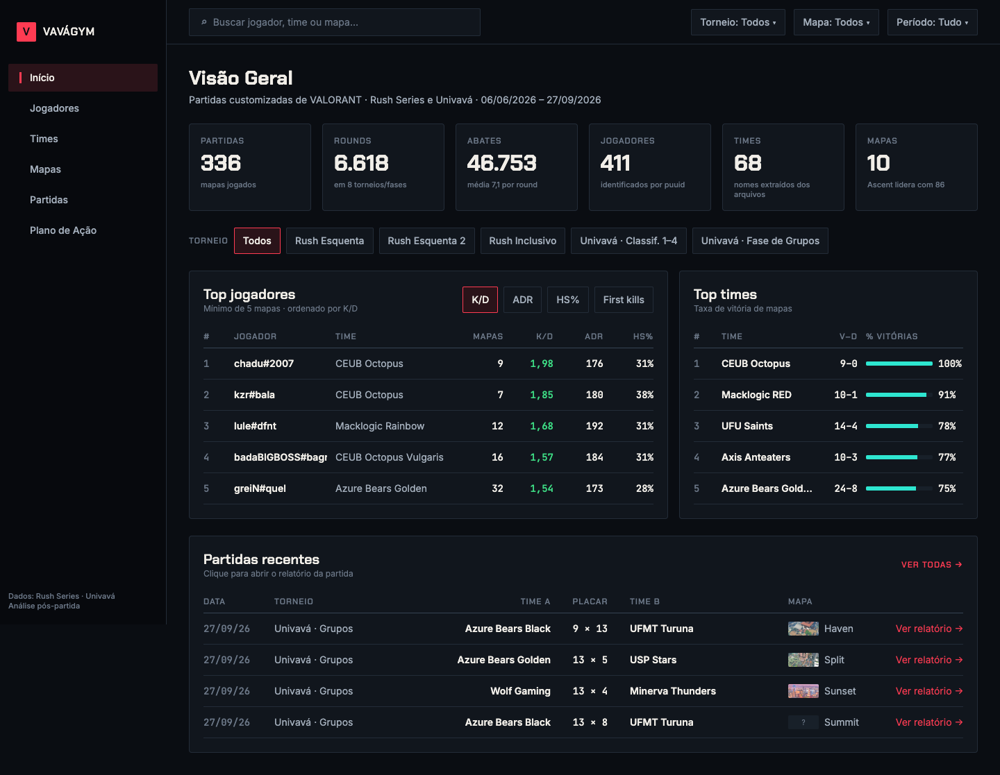
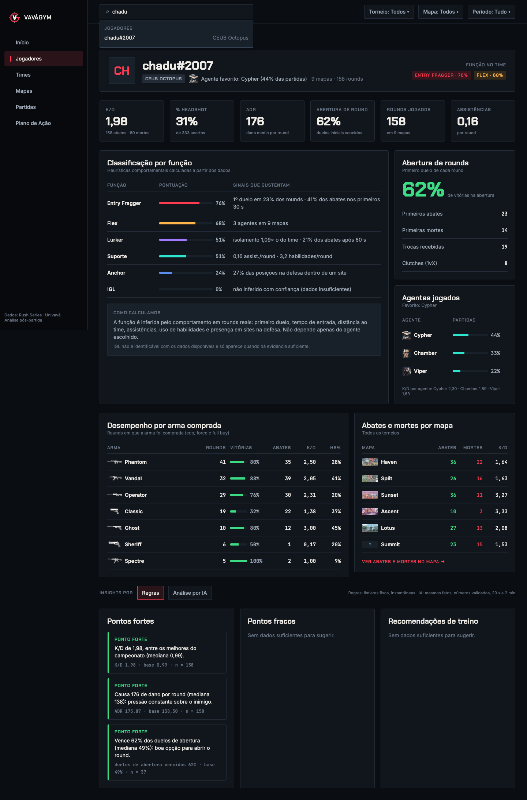
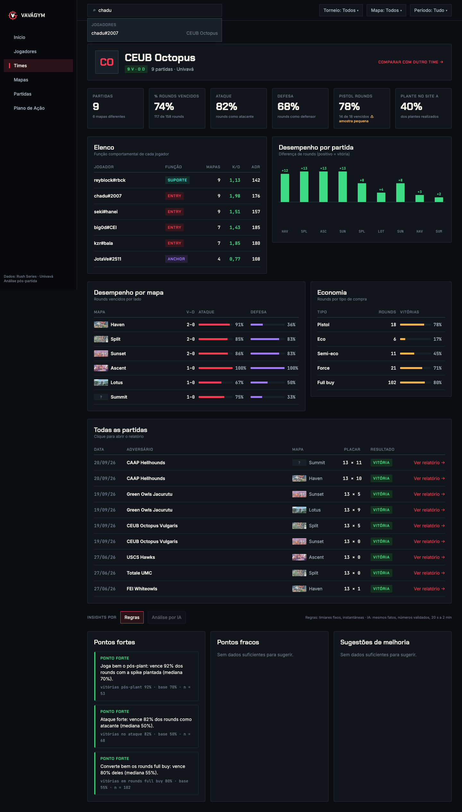
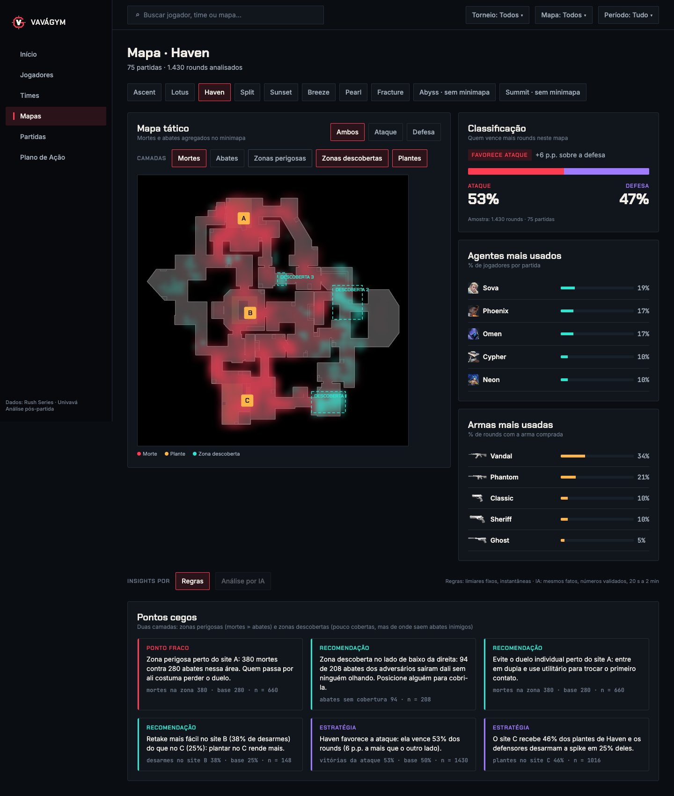
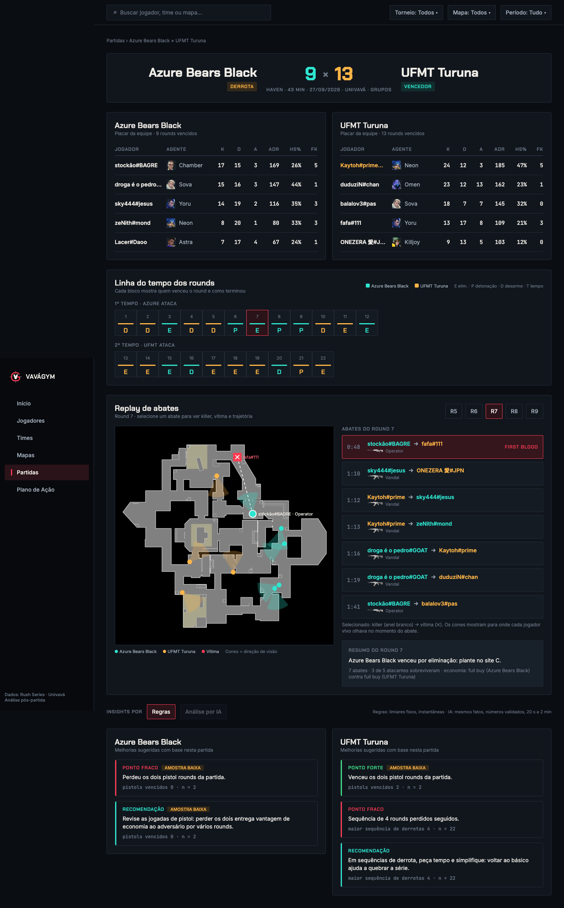
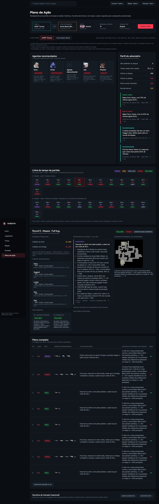

# VaváGym

**An impartial VALORANT match-analysis dashboard that turns real tournament data into evidence-backed answers, and into a round-by-round plan for the next match.**

Built for the **SEMCOMP / AcadArena Hackathon** (delivery 23/10/2026). It analyses 336 real maps from Brazilian university
tournaments (Rush Series and Univavá): 6,618 rounds, 46,753 kills and 411 players across 68 teams. The UI is in Portuguese (pt-BR);
code, API and docs are in English.



---

## Why it exists

Coaches, analysts and players have thousands of numbers and few answers. A K/D or an ADR on its own does not say *what to fix*, *where
the team keeps losing* or *what to try next round*. VaváGym answers three questions:

1. **What stands out?** Strengths, weaknesses and tips for any player, team, map or match, each one carrying its number, the
   tournament baseline and the **sample size** behind it.
2. **Where does the map punish us?** Heatmaps and blind-spot layers (dangerous zones, uncovered zones, plant sites) drawn on the real minimap.
3. **What do we do next?** An **Action Plan**: pick Team A, Team B and a map, and get a plan for *every round* of the match.

It is **impartial**: there is no fixed "our team". You pick the entity, and where it matters the perspective (for the plan).

## What you can do

| Screen | What it gives you |
|---|---|
| **Início (chat)** | "Pergunte ao VaváGym": type a question (player info, map details, a plan against a team on a map, a championship summary) and get a readable answer built from the same analyses as the dashboard, with a "Ver no dashboard" button that opens the matching page already filled. Suggestions are optional shortcuts; the sidebar works without the chat |
| **Campeonatos** | The former Home: global search (players, teams, maps), dataset KPIs, leaderboards, recent matches, tournament/map/period filters (`/campeonatos`) |
| **Player** | K/D, ADR, HS%, opening duels, per-map and per-agent/weapon splits, behavioural roles (top 2 + confidence + signals), strengths / weaknesses / tips |
| **Team** | Record and trend, roster and roles, attack vs defense, economy by round type (pistol, eco, force, full buy), per-map results, recommendations |
| **Map** | Attack/defense bias, site preference and retake, kill/death heatmaps by side, blind-spot layers, usage of agents |
| **Match report** | Scoreboard with MVP, round timeline, **kill replay on the minimap** (killer view direction included), per-team improvement suggestions |
| **Action Plan** | Team A vs Team B on a map → one entry per round: predicted round type, projected economy, buy, strategy, enemy weak points, probable enemy move, and a contingency if the previous round is won or lost |

<table>
<tr>
<td></td>
<td></td>
</tr>
<tr>
<td></td>
<td></td>
</tr>
</table>

### The Action Plan in detail



For a full match (default 12 + 12 rounds, configurable) the planner simulates the match round by round:

- **Sides and round type.** Sides swap at halftime; rounds 1 and 13 are pistols. Otherwise the round type (eco, semi-eco, force, full buy) is the most likely one given the previous round, from each team's own transition history, then downgraded if the team cannot afford it.
- **Economy.** Credits are projected round to round for both teams (validated against real credits, median error below 400).
- **Win probability.** A small logistic model (numpy, ridge-regularised) validated on **93 held-out matches** (log-loss 0.623 vs 0.640 for the empirical baseline: a modest, honest gain). Results of the base scenario are spread by probability instead of always picking the favourite, so the plan does not collapse into one long streak.
- **Buy.** Per player slot, the weapon and armour the player (or team) actually bought most in that round type.
- **Strategy.** Candidate plays (target site, timing, early tempo, momentum lines) scored with shrunk empirical rates, with rotation after losses and repeats so the plan has variety.
- **Enemy.** Weak points from the rule engine applied to the opponent, probable site with evidence, and an enemy route (typical positions from real snapshots) shown on a small minimap.
- **Contingency.** What the next round type becomes if this one is won vs lost, with probability and sample size.

**PDF dossier.** "Exportar PDF" downloads a text-first document, not a copy of the page. The plan's facts and the list of available image slots (overview minimap, the enemy's probable route per site, agent portraits, each round's weapons) go to the AI, which writes the playbook as structured blocks (sections, paragraphs, bullets and image *placeholders*); the code validates every block (numbers must exist in the plan, no statistics recited, no utility/ability talk, no direct address to the reader), fills the placeholders with catalog images, and lays it out with ReportLab. A compact round-by-round table is always appended by code. Anything the catalog does not know (an agent or weapon without a name or icon, a map without a minimap) is shown as a labeled placeholder and explained in a "Notas sobre os dados" section, never silently left out. Without a key, or if the AI fails, a deterministic document with the same layout is produced, so the export always works.

**Known limit, stated in the app:** the files contain no utility, lineup or callout data, so plans cover positioning, timing, roles and economy only.

---

## How the analysis works (and why you can trust it)

```
data/*.json ──► loader ──► in-memory Store ──► metrics ──► analytics (players/teams/maps/matches)
                                                   │                 │
                                                   └──► insights ◄───┘──► FastAPI ──► React
```

- **Evidence on everything.** Every insight is `{kind, text_pt, evidence{metric, value, baseline, sample_size}, low_sample}`. No number appears in a sentence that is not in its evidence.
- **Percentile thresholds, not magic numbers.** Strength = top 20% of the qualified population, weakness = bottom 20% (players with at least 100 rounds, teams with at least 3 matches). Calibrated by script, so strengths and weaknesses are a minority, not everywhere.
- **Sample size is part of the contract.** `low_sample` flags values from thin data; the UI shows an amber badge. Rules stay silent below a hard minimum.
- **Behavioural roles.** Role scores are percentiles of behavioural signals (opening duels, entry timing, distance to the team, assists, presence on sites...) against the whole dataset: top 2 with confidence and the signals behind them. IGL is deliberately not guessed.
- **Rules first, always on.** The whole app works offline with deterministic rules. No database: the JSON files are loaded into memory at startup (about 1 s from the disk cache).

### AI layer (Gemini only, on whenever a key is set)

When enabled, an **"Análise por IA"** toggle appears on the Player, Team, Map and Match pages, and the Action Plan can generate a coach-style narrative. The model never owns a number:

- It receives **fact packets with ids** and must cite them; the code validates ids, allowed kinds, team ownership and that **every number in the text equals a cited fact's value, reference or sample size**.
- A **coherence guard** rejects a "strength" on a fact that is not top-band, a "weakness" in the wrong direction, and low-sample facts used as strengths/weaknesses.
- Anything that fails falls back to the rule-based text and is reported in the notes. Answers are cached on disk.
- **Chat:** the answers always come from the engines; with a key the model only (a) understands free-form sentences the offline keyword/fuzzy rules cannot place (every name it returns is re-checked against the dataset) and (b) writes an optional short interpretive paragraph, shown only if it passes the same number and tone checks and does not talk about utility (the dataset has none).
- In a measured comparison on 14 entities, the AI produced 93 insights vs 61 from rules and 25 strategies vs 4, but takes 20 s to 2 min and sometimes over-claims; hence the hybrid design (rules by default, AI on demand). Details: [`.claude/docs/insights-comparison.md`](.claude/docs/insights-comparison.md).

---

## Quick start

Requirements: Python 3.11+, Node 20+ and `make`.

```bash
make setup      # creates backend/.venv and runs npm install
make dev        # API on :8000 and web on :5173 (Vite proxies /api and /assets)
```

Open <http://localhost:5173>.

| Command | What it does |
|---|---|
| `make dev` | Backend and frontend together |
| `make dev-api` / `make dev-web` | Each one on its own |
| `make dev-mock` | Frontend only, answering from contract fixtures (no backend needed) |
| `make test` | Backend `pytest` + frontend `tsc` |
| `make fixtures` | Regenerates the contract fixtures |
| `cd frontend && npm run smoke` | Browser smoke test: every route, at 1440 and 1024 px (needs `make dev` running) |
| `cd frontend && npm run demo-flow [dir]` | Clicks through the demo storyline and saves screenshots |

### Enabling the AI mode (optional)

```bash
cp .env.example .env
# edit .env: set GEMINI_API_KEY (Google AI Studio key). That is all: the AI layer is on when a key exists
```

Restart `make dev`. The key can also come from the environment (`GEMINI_API_KEY` or `GOOGLE_API_KEY`); a real environment variable wins over `.env`, which is git-ignored.
Models are tried in order (`gemini-3-flash-preview`, `gemini-flash-latest`, `gemini-3.5-flash`, then Gemma 4 as quota-independent fallbacks);
`VAVAGYM_LLM_MODEL` forces a single one. Without a key the AI buttons are disabled and everything else works; set `VAVAGYM_LLM=0` to switch the AI layer off even with a key.

---

## Tech stack

- **Frontend:** React 18, Vite 6, TypeScript, Tailwind CSS v4, TanStack Query, React Router. Dark, VALORANT-inspired theme with original styling (no Riot logos or fonts). Charts are SVG; the minimap is a canvas component with arrows, routes, zones and heat.
- **Backend:** Python 3.11, FastAPI, pandas, numpy. No database, no scikit-learn: the win model is a small numpy ridge-logistic.
- **Design:** every page follows the Figma file (page "Frontend v0"); deviations are recorded in the plan.

## Repository map

```
backend/app/
  data/         filename parser, loader + pickle cache, Store, catalog, coordinate transform
  metrics/      events, players, rounds, objectives (definitions in SPEC.md)
  analytics/    player / team / map / match builders, heatmaps, replay, role model
  insights/     thresholds + baselines, rules_*.py, zones, scouting, plays, action_plan,
                play_model, and the optional llm layer (llm.py, llm_insights.py)
  routers/      HTTP endpoints         schemas/   Pydantic contract
backend/tests/  pytest suite (168 tests: loader, metrics, rules, plan, LLM with a fake client, contract)
backend/scripts/ calibration, coordinate check, insight comparison, showcase picker, make_report (PDF without a server)
frontend/src/   pages/, components/{ui,map,layout,home}, api/ (types, hooks, mock)
frontend/scripts/ Playwright: smoke, demo-flow, shot, round-click, AI-insights checks
contract/       openapi.md + fixtures      data/   the 336 match JSON files
public_catalog/ agent, weapon and map images and ID lookups
.claude/        plans, project details, data reports, pitch kit
```

### API at a glance

`GET /api/meta · /search · /leaderboards · /matches · /players/{puuid} · /teams · /teams/{name} · /maps · /maps/{name} · /maps/{name}/heatmap · /matches/{id} · /matches/{id}/kills` and `POST /api/plan` (+ `GET /api/plan/capabilities`).
The profile endpoints take `?insights=rules|llm`. Full contract: [`contract/openapi.md`](contract/openapi.md); data tables: [`backend/app/data/SCHEMA.md`](backend/app/data/SCHEMA.md); metric definitions: [`backend/app/metrics/SPEC.md`](backend/app/metrics/SPEC.md).

---

## Data notes

Details in [`.claude/docs/data-report.md`](.claude/docs/data-report.md). The ones that shaped the code:

- Team names and final scores exist **only in filenames**; Red/Blue is mapped to teams by matching the filename score with `teams[].roundsWon` (all 336 files parse, including series suffixes).
- Red/Blue is a colour, not a side: attack and defense swap at halftime.
- Observers are excluded; empty values appear as `null`, `""` and `(0,0)`.
- Map codenames differ from public names (Jam=Lotus, Triad=Haven, Bonsai=Split, Juliett=Sunset, Foxtrot=Breeze, Pitt=Pearl, Canyon=Fracture...). Abyss and Summit have no minimap in the catalog and the UI says so.
- The catalog is outdated: unknown agents, weapons and armours are shown as unknown or clearly labelled as inferred, never invented.
- Coordinates were validated by plotting plants on the minimaps ([`docs/coords-check.png`](docs/coords-check.png)).

## Rules compliance

- Match data comes **only** from the supplied JSON files: no scraping, no external stats APIs.
- Post-match and preparation analysis only; nothing that helps during a live match.
- No Riot logos or fonts; catalog images are the supplied ones (usage confirmed by the organisers).
- The AI layer is always on when a key is configured (rules remain the default view and the fallback), and it never invents numbers.

## Limits and next steps

- No utility, lineup or callout data in the files; with it, plans could name abilities and lineups.
- Roles are behavioural estimates, not official roles.
- Enemy weak points are often empty against very strong opponents (not enough evidence to claim one).
- AI mode is slow and depends on a free-tier quota; it always falls back to rules.
- Laptop layout (1024 px and up); not tuned for phones.

## Contributing and project docs

Read [`CLAUDE.md`](CLAUDE.md) and [`.claude/plans/mvp-plan.md`](.claude/plans/mvp-plan.md) (the canonical plan, on `main`) first, then [`CONTRIBUTING.md`](CONTRIBUTING.md).
Pitch material for the hackathon: [`.claude/docs/pitch-kit.md`](.claude/docs/pitch-kit.md).
